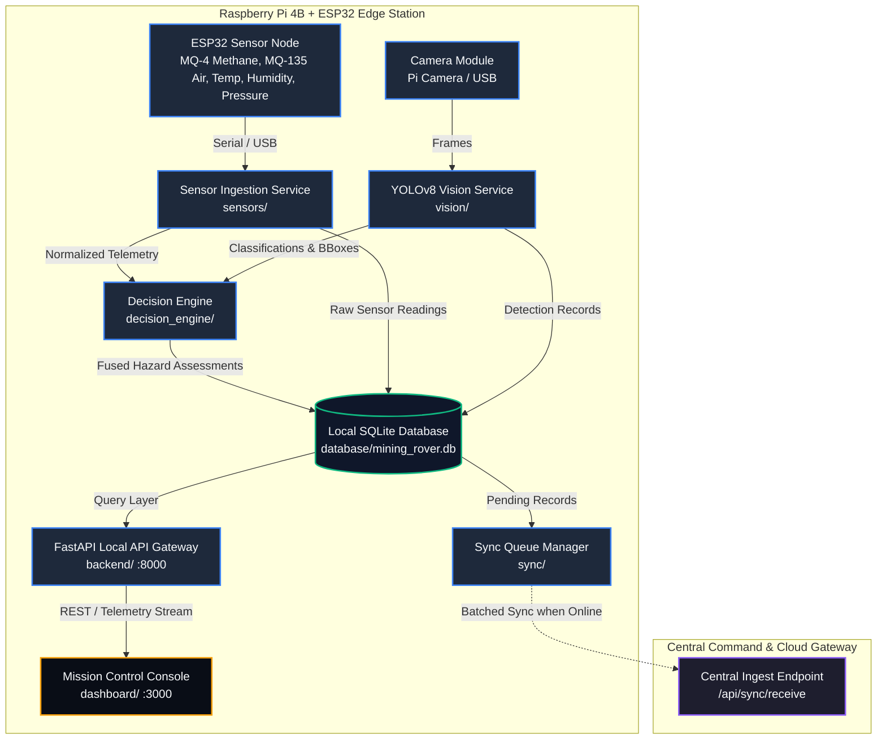

# 🚜 Mining Rover Autonomous Monitoring System
### Offline-First Edge Intelligence, Multi-Sensor Fusion & Hazardous Environment Mission Control

[](https://github.com/sumed/Mining_Rover_software/actions)
[](https://www.python.org/downloads/)
[](https://fastapi.tiangolo.com)
[](https://ultralytics.com)
[](https://www.sqlite.org)
[](https://www.raspberrypi.com/)
[](LICENSE)
[](#-verification--test-coverage)

---

## 📖 Overview

The **Mining Rover Software System** is an industrial-grade, offline-first autonomous environmental monitoring platform designed to operate underground where internet connectivity is intermittent or completely unavailable.

Deployed on edge hardware (**Raspberry Pi 4B 8GB** paired with an **ESP32 Environmental Sensor Node** and a **USB/Pi Camera**), the rover collects atmospheric telemetry, runs on-device **YOLOv8** computer vision inference for hazard detection (fire, smoke, obstacles, personnel), fuses multi-modal signals using a deterministic **Decision Engine**, persists all observations into local **SQLite** with WAL mode, and serves a modern, low-latency **Mission Control Dashboard**.

When surface network connectivity becomes available, a resilient **Offline-First Synchronization Engine** automatically uploads backlogged records with strict deduplication and exponential backoff retry.

---

## 🏛️ System Architecture



---

## ⚙️ Core Subsystems

| Subsystem | Key Components | Description |
|:---|:---|:---|
| **Phase 1: Sensor Ingestion** | `sensors/` | Hardware-resilient ESP32 serial reader, packet parser, schema validation (`StandardSensorReading`), bounds checking, and realistic hazard scenario simulator. |
| **Phase 2: Decision Engine** | `decision_engine/` | Deterministic multi-modal sensor fusion rules. Evaluates gas leaks, high thermal zones, fire, smoke, and air toxicity with confidence scores and explainable reasons. |
| **Phase 3: Database & Storage** | `database/` | Local SQLite store with Write-Ahead Logging (WAL), transaction safety, idempotent migrations, domain repositories, and sync queue tables. |
| **Phase 4: FastAPI Local API** | `backend/` | High-throughput REST API gateway with 30+ endpoints for telemetry, decisions, vision, missions, spatial locations, and activity logs. |
| **Phase 5: Mission Control UI** | `dashboard/` | High-density industrial dark-mode operations console providing live telemetry, video feed, hazard alerts, mission management, and system health status. |
| **Phase 6: Offline-First Sync** | `sync/` | Network monitor, transactional FIFO queue manager, central deduplication engine, exponential retry backoff, and system health aggregator. |
| **Phase 7A: Deployment Tooling** | `deployment/` | Self-contained deployment checker (`check_deployment.py`), systemd service unit (`mining-rover.service`), and automated setup script (`deploy_pi.sh`). |

---

## 🚀 Quick Start (Development)

### Prerequisites
- **Python:** 3.10, 3.11, or 3.12
- **Node.js:** v18+ & npm
- **Git**

### 1. Clone & Initialize Environment

```bash
# Clone the repository
git clone https://github.com/sumed/Mining_Rover_software.git
cd Mining_Rover_software

# Create and activate Python virtual environment
python -m venv .venv
source .venv/bin/activate       # Linux / macOS
# .venv\Scripts\Activate.ps1   # Windows PowerShell

# Install runtime and development dependencies
pip install -r requirements.txt -r requirements-dev.txt
```

### 2. Configure Environment

```bash
cp .env.example .env
```

### 3. Run the Backend API

```bash
python start_rover.py --health-report
```
*Backend runs at `http://localhost:8000` (Interactive API docs at `http://localhost:8000/docs`).*

### 4. Run the Dashboard

In a second terminal:
```bash
cd dashboard
npm install
npm run dev
```
*Open [http://localhost:3000](http://localhost:3000) in your browser.*

---

## 📡 API Reference Overview

The local FastAPI gateway exposes clean, OpenAPI-compliant endpoints:

| Method | Endpoint | Description |
|:---:|:---|:---|
| `GET` | `/` | Service identity and offline-first mode status |
| `GET` | `/health` / `/api/health` | Subsystem connectivity and database health |
| `GET` | `/api/system/status` | Aggregated software & hardware operational health |
| `GET` | `/api/sensors/latest` | Latest environmental readings ($T, H, P, \text{MQ-4}, \text{MQ-135}$) |
| `GET` | `/api/sensors/history` | Paginated sensor history with timestamp filters |
| `POST`| `/api/sensors` | Ingest sensor telemetry packet |
| `GET` | `/api/vision/latest` | Latest YOLO object detections |
| `POST`| `/api/vision/detect` | Upload multipart image frame for live YOLO inference |
| `GET` | `/api/vision/camera/devices` | Enumerate available USB / Pi Camera capture devices |
| `GET` | `/api/decisions/latest` | Latest fused decision engine hazard classification |
| `GET` | `/api/decisions/history` | Filtered decision records (by severity or hazard type) |
| `GET` | `/api/mission/current` | Active mission metadata, elapsed duration, and stats |
| `POST`| `/api/missions` | Create and start new exploration mission |
| `GET` | `/api/locations` | Stored 3D coordinate and RFID checkpoint markers |
| `GET` | `/api/logs` | Mission activity and audit log stream |
| `GET` | `/api/sync/status` | Sync queue depth, pending records, and connectivity |
| `POST`| `/api/sync/trigger` | Trigger manual synchronization cycle |
| `POST`| `/api/sync/receive` | Remote server batch ingest with UUID deduplication |

---

## 🧪 Verification & Test Coverage

The codebase includes an extensive testing framework verifying unit logic, integration pipelines, failure injection, and hardware fault tolerance:

```bash
# 1. Run full unit and integration test suite (193 tests)
python -m pytest tests/ -v

# 2. Run complete end-to-end acceptance testing matrix (52 integration tests)
python scripts/acceptance_test_runner.py

# 3. Run target hardware deployment pre-flight verification
python deployment/check_deployment.py --verbose
```

### Verification Matrix Summary:
- **Pytest Suite:** 193 / 193 Passed (100%)
- **Functional Acceptance Matrix:** 52 / 52 Passed (100%)
- **Total Executed Assertions:** **245 Passed** (0 Failures)

---

## 🍓 Raspberry Pi Deployment Guide

For production setup on a **Raspberry Pi 4B (64-bit OS)**:

1. Follow the comprehensive [Deployment Guide](deployment/README.md).
2. Run the deployment verification script:
   ```bash
   python deployment/check_deployment.py
   ```
3. Install and enable the production `systemd` unit:
   ```bash
   chmod +x deployment/deploy_pi.sh
   sudo ./deployment/deploy_pi.sh --install
   ```
4. Check service status:
   ```bash
   sudo systemctl status mining-rover.service
   ```

---

## 📂 Repository Structure

```
Mining_Rover_software/
├── .github/                 # GitHub CI workflows and issue/PR templates
├── backend/                 # FastAPI REST API, schemas, routes, and services
├── config/                  # rover_config.yaml & configuration loaders
├── dashboard/               # Next.js / React Mission Control Dashboard
├── database/                # SQLite connection, repositories, and migrations
├── decision_engine/         # Multi-modal sensor fusion and hazard rules
├── deployment/              # Systemd unit, deploy script, and check_deployment.py
├── docs/                    # Architecture and developer documentation
├── models/                  # YOLOv8 model weights (.pt / .onnx)
├── scripts/                 # Acceptance test runners & diagnostic utilities
├── sensors/                 # ESP32 serial drivers, packet parsers, simulator
├── sync/                    # Offline-first queue, network monitor, health checker
├── tests/                   # Full pytest suite (Phases 1–7A)
├── vision/                  # YOLO inference and camera stream services
├── .env.example             # Template for environment variables
├── .gitattributes           # Universal line-ending configurations
├── .gitignore               # Comprehensive production gitignore
├── CONTRIBUTING.md          # Contribution guidelines
├── LICENSE                  # MIT License
├── README.md                # Project documentation
├── requirements.txt         # Production runtime Python dependencies
├── requirements-dev.txt     # Developer & testing dependencies
└── start_rover.py           # Unified entrypoint & startup orchestrator
```

---

## 📄 License

Distributed under the **MIT License**. See [`LICENSE`](LICENSE) for details.
